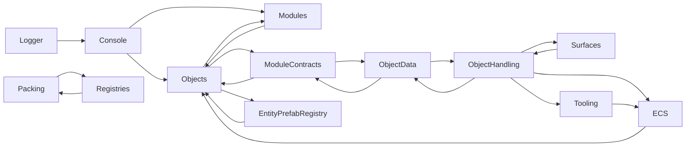

# Current state

[Back to the summary](README.md)

This section maps the code as it stands on `main` (`a77a8c1`, package version 1.0.1) and notes where the `dev` branch
(version 1.1.9, upstream PR #74) already changes the picture. Every claim names the file it comes from. Line counts
come from `wc -l`. Nothing was compiled, because no Unity editor was available for this review. Statements about
runtime behavior are read from the code and are marked as expected behavior where a Unity run is needed to confirm
them.

The short version: the code is consistent in style, the newer areas (packing, registries, logging on `dev`) are
carefully built, and `dev` already fixes several of the issues below. What holds the package back is structure. One
assembly holds everything, and its folders depend on each other in cycles.

## Package and assembly today

`package.json` declares Unity `6000.0` (`unityRelease` `40f1`) and eight dependencies: Entities 1.3.14, Entities
Graphics 1.3.14, Mathematics 1.3.2, Burst 1.8.19, Collections 2.5.7, Unity Physics 1.3.14, Input System 1.11.2, and
uGUI 2.0.0. On `dev`, `package.json` drops Unity Physics.

`Runtime/SpellBound.Core.asmdef` defines one assembly, `Spellbound.Core`, with `autoReferenced: true`,
`allowUnsafeCode: true`, and `overrideReferences: true`. It references eleven assemblies by GUID. Each GUID was
resolved by reading the matching `.asmdef.meta` file in the public `needle-mirror` copies of Unity's packages, because
no Unity package cache exists on the review machine.

| GUID | Assembly | Package | Used by the code? | Source |
| --- | --- | --- | --- | --- |
| `d8b63aba1907145bea998dd612889d6b` | Unity.Mathematics | com.unity.mathematics | Yes | [meta][g-math] |
| `734d92eba21c94caba915361bd5ac177` | Unity.Entities | com.unity.entities | Yes | [meta][g-ent] |
| `2665a8d13d1b3f18800f46e256720795` | Unity.Burst | com.unity.burst | Yes | [meta][g-burst] |
| `e0cd26848372d4e5c891c569017e11f1` | Unity.Collections | com.unity.collections | Yes | [meta][g-coll] |
| `a5baed0c9693541a5bd947d336ec7659` | Unity.Transforms | com.unity.entities | Yes | [meta][g-tr] |
| `63afb046c8423dd448ae7aba042ea63d` | Unity.Physics | com.unity.physics | No | [meta][g-phys] |
| `e00140a815de944528348782854abe39` | Unity.Physics.Hybrid | com.unity.physics | No | [meta][g-physh] |
| `6055be8ebefd69e48b49212b09b47b2f` | Unity.TextMeshPro | TextMeshPro, part of uGUI 2.0 | Yes, console only | [meta][g-tmp] |
| `75469ad4d38634e559750d17036d5f7c` | Unity.InputSystem | com.unity.inputsystem | Yes, console only | [meta][g-input] |
| `8819f35a0fc84499b990e90a4ca1911f` | Unity.Entities.Hybrid | com.unity.entities | Yes, bakers | [meta][g-enth] |
| `7a450cf7ca9694b5a8bfa3fd83ec635a` | Unity.Entities.Graphics | com.unity.entities.graphics | One disabled system | [meta][g-gfx] |

[g-math]: https://raw.githubusercontent.com/needle-mirror/com.unity.mathematics/master/Unity.Mathematics/Unity.Mathematics.asmdef.meta
[g-ent]: https://raw.githubusercontent.com/needle-mirror/com.unity.entities/master/Unity.Entities/Unity.Entities.asmdef.meta
[g-burst]: https://raw.githubusercontent.com/needle-mirror/com.unity.burst/master/Runtime/Unity.Burst.asmdef.meta
[g-coll]: https://raw.githubusercontent.com/needle-mirror/com.unity.collections/master/Unity.Collections/Unity.Collections.asmdef.meta
[g-tr]: https://raw.githubusercontent.com/needle-mirror/com.unity.entities/master/Unity.Transforms/Unity.Transforms.asmdef.meta
[g-phys]: https://raw.githubusercontent.com/needle-mirror/com.unity.physics/master/Unity.Physics/Unity.Physics.asmdef.meta
[g-physh]: https://raw.githubusercontent.com/needle-mirror/com.unity.physics/master/Unity.Physics.Hybrid/Unity.Physics.Hybrid.asmdef.meta
[g-tmp]: https://raw.githubusercontent.com/needle-mirror/com.unity.textmeshpro/master/Scripts/Runtime/Unity.TextMeshPro.asmdef.meta
[g-input]: https://raw.githubusercontent.com/needle-mirror/com.unity.inputsystem/master/InputSystem/Unity.InputSystem.asmdef.meta
[g-enth]: https://raw.githubusercontent.com/needle-mirror/com.unity.entities/master/Unity.Entities.Hybrid/Unity.Entities.Hybrid.asmdef.meta
[g-gfx]: https://raw.githubusercontent.com/needle-mirror/com.unity.entities.graphics/master/Unity.Entities.Graphics/Unity.Entities.Graphics.asmdef.meta

Three findings follow from the table.

- **Unity Physics is referenced but unused.** No file under `Runtime/` or `Editor/` has a `Unity.Physics` using. The one
  physics call, `Physics.Raycast` in `Runtime/Console/ConsoleCommandRouter.cs`, is the built-in physics module, not
  the Unity Physics package. `dev` removes the package from `package.json`, but the `dev` asmdef still lists both
  Unity Physics GUIDs.
- **uGUI is used but not referenced.** `Runtime/Console/ConsoleController.cs` uses `ScrollRect` from `UnityEngine.UI`.
  The asmdef does not list the `UnityEngine.UI` assembly (GUID `2bafac87e7f4b9b418d9448d219b01ab` in the
  [uGUI mirror][g-ui]). We could not confirm from here how this resolves under uGUI 2.0, which folded TextMeshPro into
  uGUI. Check it in Unity, and reference the assembly explicitly either way.
- **Unsafe code is enabled but not used.** No file contains the `unsafe` keyword. `allowUnsafeCode` can be turned off.

[g-ui]: https://raw.githubusercontent.com/needle-mirror/com.unity.ugui/master/Runtime/UnityEngine.UI.asmdef.meta

On `main`, `Editor/` has no assembly definition, and both editor scripts wrap themselves in `#if UNITY_EDITOR`. In a
package, a folder named `Editor` is only a convention and does not make scripts editor-only, per Unity's
[package layout page](https://docs.unity3d.com/Manual/cus-layout.html). `dev` adds `Editor/Spellbound.Core.Editor.asmdef`
(editor platform only) and `Tests/Spellbound.Core.Tests.asmdef` (EditMode, `autoReferenced: false`, gated on
`UNITY_INCLUDE_TESTS`) with 15 test files. That is a good base for Phase 0.

Upstream issue #79 shows that the package is developed inside a host project at `CoreDev/Assets/Core/`. Code inside
`Assets/` follows looser compilation rules than code in an installed package. Problems such as a missing asmdef can
stay hidden until a game installs the package. CI that installs the package the way a game does closes that gap.

## What each folder does and what it depends on

| Folder | Responsibility | Unity packages it uses | Other folders it uses |
| --- | --- | --- | --- |
| `Runtime/Logger/` | Static `Log` facade with compile-time stripping, sinks, `LogConfig` asset, bootstrap | None (engine only) | Console, through `Sinks/GameConsoleSink.cs` |
| `Runtime/Hashing/` | `StableHash.Fnv1A32` | None | None |
| `Runtime/Packing/` | `Packer` binary read and write, `IPacker`, tagged `ISmartPacker`, `SmartPackerRegistry` | None | Hashing, Logger, Registries |
| `Runtime/Registries/` | `IRegistry`, `HashRegistry`, `HashedScriptableObject`, collision guard, `RegistryPacker` | None | Hashing, Logger, Packing, Tooling |
| `Runtime/ObjectPooling/` | Abstract `ObjectPool<T>` | None | None |
| `Runtime/Tooling/` | `SingletonManager`, `ObservableArray`, `[Immutable]`, proximity math and job | Burst, Collections, Mathematics, Entities (Transforms) for the proximity job | ECS |
| `Runtime/Console/` | Command registries, parser, routing, `ConsoleController` view | uGUI, TextMeshPro, Input System (all in `ConsoleController.cs`) | Objects, Modules |
| `Runtime/Objects/` | `ObjectPreset`, `PresetRegistry`, `PresetSurface`, tooltip types | Entities (`ObjectPresetUtils.cs`) | EntityPrefabRegistry, Hashing, Logger, ModuleContracts, Modules, Registries, Surfaces, Tooling |
| `Runtime/Modules/` | `PresetModule` base class | None | Objects |
| `Runtime/ModuleContracts/` | Create, change, delete, delta, dispatch, timer, and tooltip interfaces for modules | None | ObjectData, ObjectHandling, Objects, Packing, Surfaces |
| `Runtime/ObjectData/` | Instance entries, data keys, data access interfaces, `DeltaResolver` | None | Logger, ModuleContracts, ObjectHandling, Objects, Packing, Surfaces |
| `Runtime/ObjectHandling/` | `ObjectParent`, `TransformData`, chunk and migration interfaces | Entities, Transforms, Collections, Mathematics, Jobs | ECS, Logger, ModuleContracts, ObjectData, Objects, Packing, Surfaces, Tooling |
| `Runtime/Surfaces/` | `IEventSurface`, `StaticEventSurface` | None (built-in physics `Collider`) | Logger, ModuleContracts, ObjectData, ObjectHandling, Objects, Packing |
| `Runtime/ECS/` | Components, tags, `InstantiationSystem`, `DestroyTaggedEntitiesSystem`, preset baker | Entities, Burst, Collections, Mathematics, Transforms, Entities Graphics (one file) | Logger, ModuleContracts, Objects |
| `Runtime/EntityPrefabRegistry/` | Baked prefab lookup by preset hash | Entities, Collections | Objects, Tooling |
| `Runtime/Obsolete/` | `ProceduralObjectData`, marked `[Obsolete]` | Entities, Mathematics | None |
| `Editor/` | `LogConfigEditor` (log level defines), `ObjectPresetEditor` (UI Toolkit inspector) | None | Logger, Objects, Modules |
| `Prefabs/` | Two console canvases and the packing benchmark | uGUI and TextMeshPro components | Console, Packing |

Two facts stand out. First, the Input System, uGUI, and TextMeshPro are used by one file,
`Runtime/Console/ConsoleController.cs`. Entities Graphics is used by one file,
`Runtime/ECS/EntityBatchConsolidationSystem.cs`, which is marked `[DisableAutoCreation]` and is enabled by nothing in
the package. Second, Logger, Hashing, Packing, Registries, ObjectPooling, and the general parts of Tooling use no Unity
package at all. That is the natural Core.

## Coupling between folders

The diagram shows the cycles only, with the arrow pointing from the user to the used folder. Each cycle has a concrete
cause.

- **Logger to Console.** `Runtime/Logger/Sinks/GameConsoleSink.cs` calls `Console.ConsoleLogger`. A logging foundation
  should not know about a console. The sink belongs in the console.
- **Console to Objects.** `Runtime/Console/ConsoleCommandRouter.cs`, `Runtime/Console/PresetResolver.cs`, and
  `Runtime/Console/ListCommand.cs` resolve presets, and `Runtime/Console/ConsoleModule.cs` extends `PresetModule`. The
  general command system and the preset spawning commands are two features in one folder.
- **Objects, Modules, and ModuleContracts.** `Runtime/Modules/PresetModule.cs` stores an `ObjectPreset`, and
  `Runtime/Objects/ObjectPreset.cs` stores `PresetModule` lists and checks `IDispatch` and `ITooltipHandler`. The
  contracts in `Runtime/ModuleContracts/` take `ObjectPreset` and the concrete `ObjectParent` class
  (`IChangeHandler.cs`, `IChangeResolver.cs`, `ICreateHandler.cs`, `ICreateResolver.cs`, `IDeleteHandler.cs`,
  `IDeleteResolver.cs`). Only `IDispatch.cs` uses the `IObjectParent` interface.
- **ObjectData and ObjectHandling.** `Runtime/ObjectData/IPackerObjectData.cs` takes `ObjectParent`, and
  `Runtime/ObjectHandling/ObjectParent.cs` uses every ObjectData type.
- **Packing and Registries.** `Runtime/Packing/ISmartPacker.cs` extends `IRegistryEntry`, while
  `Runtime/Registries/RegistryPacker.cs` calls `Packer`, and `Runtime/Registries/PackerIdAttribute.cs` declares a
  `Spellbound.Core.Packing` type inside the Registries folder.
- **Tooling to ECS.** `Runtime/Tooling/EventSurfaceProximityJob.cs` reads ECS components. A folder named Tooling that
  depends on gameplay ECS components fails the stranger test.
- **Objects and EntityPrefabRegistry.** `Runtime/Objects/ObjectPresetUtils.cs` looks up the `EntityPrefabRegistry`,
  and `Runtime/EntityPrefabRegistry/EntityPrefabRegistryAuthoring.cs` loads `ObjectPreset` assets.

Cycles inside one assembly compile fine, which is why they have grown. They block any split, because an assembly
cannot reference another assembly that references it back. Breaking them is the main engineering work of Phase 1.

## Where the code strains the studio's principles

### Separation of concerns and single responsibility

- `Runtime/ObjectHandling/ObjectParent.cs` (737 lines on `main`, 757 on `dev`) creates and destroys entities, spawns
  and destroys event-surface GameObjects, schedules proximity jobs, forwards data access, and dispatches module
  callbacks. It reaches the ECS world through `World.DefaultGameObjectInjectionWorld` on nine lines, on both `main`
  and `dev`. That ties it to one world, which matters for multiplayer (see
  [Package layout](02-package-layout.md#staying-ready-for-multiplayer-and-mmo-games)).
- `Runtime/Console/ConsoleController.cs` combines the view, input binding, command history, and command execution.
- `Runtime/Packing/Packer.cs` (1,056 lines) combines primitive codecs, Unity type codecs, collection codecs, and buffer
  growth.

### SOLID

- **Interface segregation.** `Runtime/ObjectHandling/IObjectInstanceConsumer.cs` has twelve methods covering load,
  create, delete, data change, dynamic objects, and queries. On `main`, `Runtime/Surfaces/StaticEventSurface.cs`
  implements `TryRead`, `TryWrite`, and `TryDestroy` by throwing `NotImplementedException`. `dev` implements them.
- **Liskov substitution.** `Runtime/Tooling/ObservableArray.cs` implements `IList<T>` and reports `IsReadOnly` as
  false, yet `Add`, `Insert`, `Remove`, and `RemoveAt` throw.
- **Dependency inversion.** The module contracts depend on the concrete `ObjectParent` (listed above).
  `Runtime/Tooling/SingletonManager.cs` is a global service locator, used by
  `Runtime/EntityPrefabRegistry/EntityPrefabBootstrap.cs` and `Runtime/Objects/ObjectPresetUtils.cs`.

### DRY

- **Two command systems.** `Runtime/Console/CommandRegistry.cs` scans every loaded assembly for `ICommand` classes.
  `Runtime/Console/AttributeCommandRegistry.cs` scans a filtered assembly list for attributed methods and carries its own
  argument parsing next to `Runtime/Console/CommandParameterParser.cs`.
- **Repeated reflection scans.** `DeltaResolver.cs`, `SmartPackerRegistry.cs`, `AttributeCommandRegistry.cs`,
  `CommandRegistry.cs`, and `Editor/LogConfigEditor.cs` each scan assemblies their own way on `main`. `dev` adds
  `Runtime/Tooling/AssemblyScanning.cs` and moves the four runtime scanners onto it. Only `Editor/LogConfigEditor.cs`
  still scans directly. This is the right direction, and it makes the CoreCLR change in
  [Unity 6.7 and later](03-unity-6.md) a one-file edit.
- **Repeated buffer growth.** `Packer.cs` repeats the stack-then-`ArrayPool` retry loop in `PackListToBytes`,
  `SmartToBytes`, `ToBytes`, and `PackArrayToBytes`, next to `BuildPayload`, which exists to do this once.
- **Two sources for a type tag.** `Runtime/Packing/SmartPackerExtensions.cs` writes the instance's own `Hash`, while
  `Packer.SmartToBytes` writes the registry hash derived from `[PackerId]`. If the two disagree for a type, the two paths
  write different bytes for the same value.
- **Engine overlap.** `Runtime/ObjectPooling/ObjectPool.cs` covers ground that Unity's `UnityEngine.Pool.ObjectPool<T>`
  already covers. Keep it only if it earns its place, for example through the cap and prewarm hooks `dev` adds.

### YAGNI

These types have no caller or implementer inside the package: `Runtime/Logger/LogSourceAttribute.cs`,
`Runtime/ObjectHandling/IChunkManager.cs`, `Runtime/ObjectHandling/IMigratable.cs`,
`Runtime/ModuleContracts/ICreateResolver.cs`, `Runtime/ObjectData/InstanceEntry.cs`,
`Runtime/ObjectData/ProceduralStaticInstanceEntry.cs`, `Runtime/Objects/TooltipData.cs`,
`Runtime/Obsolete/ProceduralObjectData.cs`, and the private `GetExecutionPosition` method in
`Runtime/Console/ConsoleCommandRouter.cs`. Games may use some of the public ones. A one-time search of the studio's
game repositories decides which to delete and which to keep.

`Runtime/Packing/FastPackerBenchmark.cs` is a `MonoBehaviour` that ships in the runtime assembly on `main`. `dev` moves
it to `Samples/`, which still compiles into the package. Unity's convention is a `Samples~` folder that games import
on request.

### Game vocabulary in a general foundation

Some types name a particular game's concepts: `TooltipSource` with `World`, `Inventory`, and `Talent`
(`Runtime/Objects/TooltipSource.cs`), `IAwardReciever` (`Runtime/ObjectData/IAwardReciever.cs`), timer tagging
(`Runtime/ModuleContracts/ITimerModule.cs`, `Runtime/ECS/TimerModuleTag.cs`), and seed-instance deletions
(`Runtime/ObjectData/IObjectDataAccess.cs`). Chunks and seeds may be general to every Spellbound world game. Inventory
and talent tooltips are unlikely to be. These should move to the games or to a later gameplay package.

## Static state and play mode

Several types keep state in static fields that survive entering play mode when domain reload is off. Unity 6.6 makes
that the default for new projects, and Unity 7 removes domain reload entirely (sources in
[Unity 6.7 and later](03-unity-6.md)).

- `Runtime/Logger/Log.cs` on `main` never clears its sink array, and `LogBootstrap` adds sinks on every play. We expect
  duplicated output with domain reload off. `dev` 1.1.5 fixes this with `Log.ClearSinks`.
- `Runtime/Console/CommandRegistry.cs` holds a static instance, and `ConsoleController.Awake` registers every command
  again on each play, which logs a duplicate warning per command.
- `Runtime/Console/AttributeCommandRegistry.cs` caches `MonoBehaviour` instances in a static dictionary. After a scene
  change, we expect the cache to return destroyed objects.
- `Runtime/ObjectData/DeltaResolver.cs` and `Runtime/Console/PresetResolver.cs` never reset.
- `Runtime/Objects/PresetRegistry.cs` and `Runtime/Packing/SmartPackerRegistry.cs` reset at `SubsystemRegistration`.
  That is the pattern the rest should copy.

## Defects found while reading

None of these block the roadmap. Each is worth a ticket. Each needs confirming in Unity.

- `Runtime/Tooling/ImmutableAttribute.cs` has `using UnityEditor;` outside its `#if UNITY_EDITOR` block, on `main` and
  `dev`. The runtime assembly targets every platform, so we expect player builds to fail on this line.
- `ObjectParent.TryGetCallbackParamsFromEventSurface` in `Runtime/ObjectHandling/ObjectParent.cs` logs when a
  sub-surface is missing, then reads `surface.Transform` on the null result.
- `ObjectParent.DynamicDistanceQuery` never fills `existingEventSurfaces` and never reads `instancesToSleep`, unlike
  `StaticEntityDistanceQuery`. Dynamic objects in range are woken on every query and never put to sleep by it.
- `Runtime/Logger/Sinks/UnityConsoleSink.cs` drops `Info` and `Verbose` messages. That may be intended. The level
  descriptions in `Editor/LogConfigEditor.cs` say `Info` calls are compiled in, so a user who picks `Info` sees
  nothing new in the Unity console.
- `Packer` reads trust length prefixes (`ReadSmartList`, `ReadString`, `ReadBytes`), and writes use `BitConverter`,
  which follows the machine's byte order. That is fine for local saves. It is not fine for bytes that cross a network
  or come from an untrusted file.

## Documentation drift

`README.md` says the console needs Unity 2021.3 or later, while `package.json` requires 6000.0. `Runtime/Logger/readme.md`
says no `Log.Verbose()` method exists, while `Runtime/Logger/Log.cs` defines one. `Prefabs/ConsoleCanvas.prefab` stores
`consolePanel` and `toggleKey` values, and `Prefabs/ConsolePrefab.prefab` stores `toggleAction`. None of those fields
exist in `ConsoleController.cs`. The `dev` changelog's 2.0.0 entry describes Core as a "UnityEngine-only dependency",
which is the goal this roadmap adopts but not yet the fact.
