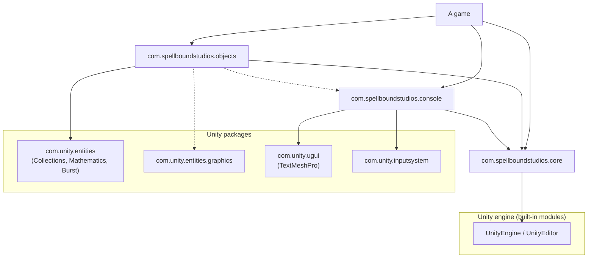
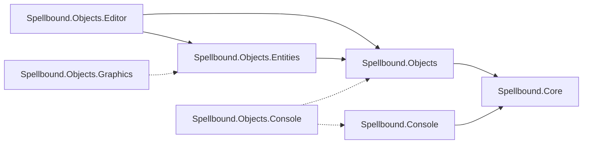

# Package layout

[Back to the summary](README.md)

This section proposes the packages to create now, what moves into each one, what each may depend on, and which
assemblies each holds. It then lists the packages to create later and the trigger for each. It ends with how the
packages stay ready for multiplayer and MMO games without containing networking code.

## Rules the layout follows

1. Core depends on the Unity engine and nothing else. The engine's built-in modules (`UnityEngine.CoreModule`, the
   UI Toolkit module, and so on) are part of the editor install and are not counted as dependencies. Core declares no
   entry in `package.json` `dependencies`.
2. Every other package depends on Core and on as few Unity packages as it can.
3. Dependencies point one way. No package, and no assembly inside a package, depends on anything that depends back on
   it.
4. A package exists only when today's code or a stated goal needs it. Everything else waits for a trigger.
5. No package contains networking code. Packages expose seams that a game's own networking layer uses.

## Packages to create now

### `com.spellboundstudios.core`

**Purpose.** The foundation every Spellbound package and game can take without cost. It holds services with no
opinion about gameplay: logging, stable hashing, the binary packer and its type registry, hash-keyed registries and
hashed assets, pooling, weighted sampling, and small inspector tools. It should be safe to add to any project, from a
prototype to a dedicated server build, without pulling in ECS, input, or UI.

**Moves in from today's code.** Everything here is already in the package. It stays.

- `Runtime/Logger/` except `Sinks/GameConsoleSink.cs`, plus the `dev` additions (`UnityLogCapture`, the tallying and
  recording sinks).
- `Runtime/Hashing/`, `Runtime/Packing/` (minus `FastPackerBenchmark.cs`, which becomes a sample),
  `Runtime/Registries/` (with `dev`'s `ResourceRegistry`), and `Runtime/ObjectPooling/`.
- `Runtime/Sampling/` from `dev`.
- The general parts of `Runtime/Tooling/`: `ImmutableAttribute.cs`, `ObservableArray.cs`, and `dev`'s
  `AssemblyScanning.cs` and `SerializeReferenceDropdownAttribute.cs`.
- Editor: `Editor/LogConfigEditor.cs`, the editor-only parts of `Runtime/Registries/HashCollisionGuard.cs` and
  `Runtime/Registries/HashedAssetTools.cs`, the `[Immutable]` drawer, and `dev`'s `SerializeReferenceDropdownDrawer.cs`.

`Runtime/Tooling/SingletonManager.cs` stays for one compatibility window, marked `[Obsolete]`. Its only callers move
to the objects package, where ECS singletons replace it.

**Allowed dependencies.** None beyond the engine. A grep of the folders above on `main` and `dev` finds no `Unity.*`
package or `TMPro` using. The one cross-folder edge to a non-Core area, `GameConsoleSink`, moves to the console.

| Today's Core dependency | Where it goes | Why |
| --- | --- | --- |
| Entities, Collections, Mathematics, Burst | Objects | Only the ECS, object-handling, and proximity code uses them |
| Entities Graphics | Objects, in an optional assembly | One disabled system uses it |
| Unity Physics | Removed | No file uses it |
| Input System | Console | Only `ConsoleController.cs` uses it |
| uGUI (with TextMeshPro) | Console | Only `ConsoleController.cs` and the console prefabs use it |

**Assemblies.**

| Assembly | Folder | Platforms | References |
| --- | --- | --- | --- |
| `Spellbound.Core` | `Runtime/` | All | None |
| `Spellbound.Core.Editor` | `Editor/` | Editor | `Spellbound.Core` |
| `Spellbound.Core.Tests` | `Tests/Editor/` | Editor | `Spellbound.Core`, `Spellbound.Core.Editor`, test runner |
| `Spellbound.Core.PlayModeTests` | `Tests/Runtime/` | All, gated on `UNITY_INCLUDE_TESTS` | `Spellbound.Core`, test runner |

### `com.spellboundstudios.console`

**Purpose.** An in-game developer console. Games register commands as classes or as attributed methods. A default
uGUI view shows input and output and binds to Input System actions. The command model lives in its own assembly, so a
game can drive it from another view (UI Toolkit, a server's standard input, a test) without uGUI.

**Moves in.** All of `Runtime/Console/` except the preset commands, plus `Runtime/Logger/Sinks/GameConsoleSink.cs`
and the console prefabs. `Prefabs/ConsoleCanvas.prefab` and `Prefabs/ConsolePrefab.prefab` are near duplicates.
Keep one. Moving the sink reverses today's Logger-to-Console arrow, because the console now uses Core's `ILogSink`.

**Allowed dependencies.** Core, uGUI 2.x (TextMeshPro ships inside it on Unity 6), and the Input System.

**Assemblies.**

| Assembly | Holds | References |
| --- | --- | --- |
| `Spellbound.Console` | `ICommand`, `CommandResult`, both registries merged behind one lookup, the parser, `help`, `clear`, the sink | `Spellbound.Core` |
| `Spellbound.Console.UI` | `ConsoleController`, prefab | `Spellbound.Console`, `UnityEngine.UI`, `Unity.TextMeshPro`, `Unity.InputSystem` |
| `Spellbound.Console.Tests` | EditMode tests of parsing and dispatch | `Spellbound.Console`, test runner |

### `com.spellboundstudios.objects`

**Purpose.** The preset-driven world-object model. An `ObjectPreset` asset describes an object. Its surfaces carry
modules that react to creation, data changes, deltas, dispatches, and deletion. Instance data lives in byte slots
keyed by packer type and surface. The ECS side bakes presets into entity prefabs, spawns instances per chunk, and
promotes nearby instances to GameObject event surfaces. The name follows today's namespace, `Spellbound.Core.Objects`.
The studio may prefer a name that says "world" (see open questions).

**Moves in.** `Runtime/Objects/`, `Runtime/Modules/`, `Runtime/ModuleContracts/`, `Runtime/ObjectData/`,
`Runtime/ObjectHandling/`, `Runtime/Surfaces/`, `Runtime/ECS/`, `Runtime/EntityPrefabRegistry/`, the proximity files
from `Runtime/Tooling/` (`EventSurfaceProximityJob.cs`, `ProximityMath.cs`, `ProximityChange.cs`),
`Editor/ObjectPresetEditor.cs`, and `dev`'s `ObjectPresetManifestPostprocessor.cs`. The console's preset commands
(`ConsoleCommandRouter.cs`, `PresetResolver.cs`, `ListCommand.cs`, and `ConsoleModule.cs`) move here as an
optional assembly. `ConsolePresetCommandAttribute.cs` stays in the console, because it names only a module `Type`.
Today `CommandRegistry.ExecuteCommand` calls `ConsoleCommandRouter.RouteCommand` directly. The console instead
exposes a fallback hook for unknown commands, and the optional assembly registers the preset router on it. `Runtime/Obsolete/ProceduralObjectData.cs` is
deleted, once a search of the games confirms nothing uses it.

**Allowed dependencies.** Core and Entities. Collections, Mathematics, and Burst come in with Entities and are named
in `package.json` only so the version floor is explicit. Entities Graphics and the console stay optional. Their
assemblies compile only when the package is present, through `versionDefines` and `defineConstraints`. `package.json`
does not list them.

**Assemblies.** The split inside this package is the main design decision. It separates data and rules from their
ECS and GameObject presentation.

| Assembly | Holds | References |
| --- | --- | --- |
| `Spellbound.Objects` | Presets, modules, contracts, instance data, data access interfaces, `DeltaResolver`, surface interfaces | `Spellbound.Core` |
| `Spellbound.Objects.Entities` | Components, systems, bakers, prefab registry, `ObjectParent`, proximity job, and the GameObject bridge `StaticEventSurface` | `Spellbound.Objects`, `Unity.Entities`, `Unity.Entities.Hybrid`, `Unity.Transforms`, `Unity.Collections`, `Unity.Mathematics`, `Unity.Burst` |
| `Spellbound.Objects.Graphics` (optional) | `EntityBatchConsolidationSystem` | `Spellbound.Objects.Entities`, `Unity.Entities.Graphics` |
| `Spellbound.Objects.Console` (optional) | Preset spawn commands | `Spellbound.Objects`, `Spellbound.Console` |
| `Spellbound.Objects.Editor` | Preset inspector, manifest postprocessor | `Spellbound.Objects`, `Spellbound.Objects.Entities` |
| `Spellbound.Objects.Tests` | EditMode tests of data, deltas, and contracts | `Spellbound.Objects`, test runner |
| `Spellbound.Objects.PlayModeTests` | World tests of spawning and proximity | `Spellbound.Objects.Entities`, test runner |

For `Spellbound.Objects` to stay free of Entities, three things change.

- The module contracts take an interface instead of the concrete `ObjectParent`. `IDispatch` already takes `IObjectParent`.
- `IObjectParent.InitializeObjectParentChunk(Vector3Int, Entity)` loses its `Entity` parameter. The ECS assembly
  supplies the entity.
- `TransformData` keeps its engine-type constructors in `Spellbound.Objects`. Its `LocalTransform` conversions move
  to extension methods in `Spellbound.Objects.Entities`.

`Spellbound.Objects.Console` lives in the objects package rather than the console package. That keeps the console
free of world objects, and it keeps the objects package free of a hard console dependency.

## Dependency graph

Arrows point from the user to what it uses. Dashed arrows are optional assemblies that compile only when the target
package is installed.

The graph is acyclic. Core has one outgoing arrow, to the engine. Console and objects each point at Core and at Unity
packages. The one arrow between two non-Core Spellbound packages, objects to console, is optional, and the console never
points back at objects, so no cycle forms. Nothing points at a game.

Inside the objects package, the assemblies form a chain with optional leaves.

## Packages to create when needed

Each package below waits for its trigger. Creating one early adds a version to maintain, a dependency to resolve, and a
place where code can land for the wrong reason.

| Package | Would hold | Trigger |
| --- | --- | --- |
| `com.spellboundstudios.packing` | `Packer`, `IPacker`, `ISmartPacker`, the registry, built with `noEngineReferences: true` | A process outside Unity, such as a .NET backend, a build tool, or a non-Unity server, must read or write the same bytes |
| `com.spellboundstudios.entities` | ECS utilities with no tie to presets, such as `PendingDestroyTag` and `DestroyTaggedEntitiesSystem` | A second ECS feature that is not about presets appears, or two games want these without the objects package |
| `com.spellboundstudios.simulation` | Fixed-step time, a deterministic random source, and fixed-point or deterministic math helpers | The first game that needs lockstep, rollback, or server replay commits to a design |
| `com.spellboundstudios.console.uitoolkit` | A UI Toolkit view for the console model | A game ships its UI on UI Toolkit and wants the console to match |
| `com.spellboundstudios.testing` | Shared test helpers, such as the recording log sink and world fixtures | Two packages copy the same test helper |
| Gameplay packages, for example loot or inventory | Game systems built on Core and objects | Two games need the same system. Until then it lives in the first game. |

The branch names in the repository (`tinker_looting`, `tinker_tooltip`, `tinker_movingobjects`) suggest the gameplay
candidates already being explored.

## Staying ready for multiplayer and MMO games

None of these packages will contain sockets, transports, sessions, replication, or matchmaking. Those belong in each
game, built on Netcode for Entities, Netcode for GameObjects, a third-party library, or the studio's own backend.
The packages make that work possible by keeping five seams clean.

1. **The byte format seam.** `Packer`, `IPacker`, and `ISmartPacker` turn state into bytes and back, and know nothing
   about where the bytes go. That is the right shape for saves, replays, and network messages alike. To be safe for
   bytes that cross machines, the format needs three changes. Write a fixed byte order with `BinaryPrimitives` instead
   of `BitConverter`. Bound every length prefix on read, and treat a bad length as a format error, because a network
   peer or a modified save is untrusted input. Add a format version to tagged payloads, so a server and an older
   client can tell when they disagree. `[PackerId]` strings already give each type a stable identity across builds.
   That is why renaming one must be treated as a breaking change.
2. **The authority seam.** `IObjectDataAccess` and `IDynamicDataAccess` in `Runtime/ObjectData/` are interfaces that
   games implement. The package never decides where the truth lives. A single-player game implements them over local
   memory and saves. A server-authoritative game implements them over the server's state, and its clients implement
   them over a predicted copy. Keep these interfaces small and free of Unity object types, so a headless server can
   implement them.
3. **The intent and delta seam.** `IPackerDispatch`, `IApplyDelta<TData, TDelta>`, and `DeltaResolver` model a change
   as an intent, a pure function that applies it, and a consequence. That is the shape a server needs to validate
   intents from clients and broadcast results. The split between `IChangeHandler` and `IChangeResolver`, and between
   `IDeleteHandler` and `IDeleteResolver`, appears to model the step between a local, predicted change and a
   confirmed one. This roadmap reads the names that way but did not find it documented, so the studio should confirm
   and document it. One rule keeps this seam safe: `ApplyDelta` must be deterministic. It reads only its inputs, and
   it calls no Unity API, no clock, and no shared random source. Tests can enforce that.
4. **The world seam.** `ObjectParent` reaches for `World.DefaultGameObjectInjectionWorld`. Netcode for Entities runs a
   client world and a server world in one process, and an MMO server may run many worlds. Pass the `World` or the
   `EntityManager` in when an `ObjectParent` is created. Replace `SingletonManager` lookups with per-world ECS
   singletons.
5. **The identity, time, and randomness seams.** Instance indices come from `ObjectParent.GetNextInstanceIndex`,
   which decides locally. In a shared world only the authority may allocate them. Put allocation behind an interface
   that the game supplies. `ITimerModule.OnTimerUpdate` already receives time as a parameter, and `dev`'s
   `WeightedTable` already takes the roll or a `System.Random` from the caller. Keep both rules for every new API, so
   no simulation code reads `Time.time` or `UnityEngine.Random` directly.

`StableHash.Fnv1A32` in `Runtime/Hashing/StableHash.cs` is already the right tool for cross-machine identity. It is
defined by its algorithm, unlike `string.GetHashCode`, which Unity notes is not stable across runs under CoreCLR (see
[Unity 6.7 and later](03-unity-6.md)).

The console fits the same pattern. Commands take strings and return a `CommandResult`. A game can expose them to a
remote admin tool through its own transport, and the console package does not need to change.
