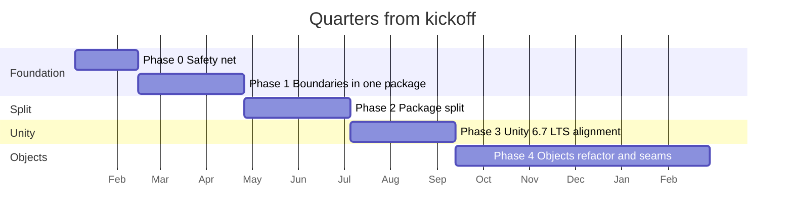

# Phased roadmap

[Back to the summary](README.md)

The phases are ordered by dependency. Each phase leaves every game working, and each one makes the next cheaper.
Timing is in quarters from kickoff. Effort is in engineer-weeks, assuming one or two engineers who know the code,
working on this part time beside game work. It excludes review time and the games' own migration work.

The chart assumes a kickoff in January 2027 only to draw the bars. Read the months as quarters from kickoff.

## Phase 0. Safety net (Q1, about six weeks)

**Goal.** Every pull request is checked automatically, and the package's declared dependencies match what the code
uses.

**Work.**

- Land upstream PR #74 (`dev` to `main`), so the tests, the editor asmdef, and the logging fixes are the baseline.
  Resolve issue #79 (organization links) in the same release.
- Add CI as described in [Engineering standards](04-engineering-standards.md#continuous-integration): lint, EditMode
  tests, a player build of a minimal host project, and an allowed-to-fail 6000.7 beta job.
- Fix what the player build finds. We expect the first finding to be the unguarded `using UnityEditor;` in
  `Runtime/Tooling/ImmutableAttribute.cs`.
- Asmdef hygiene in `Runtime/SpellBound.Core.asmdef`: remove the two Unity Physics references, add `UnityEngine.UI`
  explicitly, and turn off `allowUnsafeCode`. Keep `autoReferenced` on for now.
- Raise the minimum to Unity 6000.3 LTS and update package versions (actions 1 and 2 in
  [Unity 6.7 and later](03-unity-6.md#actions-for-this-package)).
- Add a `SubsystemRegistration` reset to every static registry, and a PlayMode test that enters play mode twice with
  domain reload off.
- Add `CODEOWNERS` and the changelog rule.
- File the defects in [Current state](01-current-state.md#defects-found-while-reading), each with a failing test.

**Why first.** Every later phase moves code. Without CI, a move that breaks a player build or a serialized asset is
found by a game team weeks later. This phase also delivers visible value on its own: a smaller dependency footprint,
support for a supported Unity version, and fewer play mode surprises.

**Entry criteria.** The studio approves this roadmap's direction and funds a Unity licence for CI.

**Exit criteria.** CI is green on 6000.3 for EditMode tests and the player build. Every asmdef reference is used. The
double-play-mode test passes.

**Effort.** S, 2 to 4 engineer-weeks.

**Risks and mitigations.**

- Unity licence activation in CI is fiddly. Follow GameCI's activation guide and budget a day for it.
- Updating Entities from 1.3 to the latest 1.x may need code changes. Do it in its own pull request, behind green
  CI, and test one game against it before release.

**Decide before starting.** The CI service, the minimum Unity patch version, and who owns CI.

## Phase 1. Boundaries inside one package (Q1 to Q2, about ten weeks)

**Goal.** The final assembly structure exists inside today's package, and the compiler enforces it.

**Work.**

- Create the assemblies from [Package layout](02-package-layout.md) inside the existing package: `Spellbound.Core`,
  `Spellbound.Console`, `Spellbound.Console.UI`, `Spellbound.Objects`, `Spellbound.Objects.Entities`, the optional
  assemblies, and their editor and test assemblies.
- Break each folder cycle listed in [Current state](01-current-state.md#coupling-between-folders). Move
  `GameConsoleSink` to the console. Replace the direct call to `ConsoleCommandRouter` with a fallback hook. Make the
  module contracts take an interface instead of `ObjectParent`. Move `PackerIdAttribute` into the packing folder and
  decide which way `ISmartPacker` and `IRegistryEntry` depend. Move the proximity job out of Tooling.
- Move types to their final namespaces with `[MovedFrom]`. Fix folder and namespace mismatches.
- Move the benchmark to `Samples~/`. Delete the types a search of the games shows are unused.
- Add PlayMode tests for spawning and proximity before touching `ObjectParent`.

**Why now.** Breaking cycles is the hard part of any split, and it is far safer inside one package, where a game
still installs a single dependency. Once the assemblies compile apart, Phase 2 is mostly moving folders.

**Entry criteria.** Phase 0 exit criteria met.

**Exit criteria.** Each assembly compiles with only its allowed references. No assembly cycle exists. Every game
in development upgrades to this release and its scenes and presets load unchanged.

**Effort.** M, 5 to 8 engineer-weeks. Most of it is in the objects area.

**Risks and mitigations.**

- `[SerializeReference]` data fails to load after a namespace move. Add `[MovedFrom]` in the same commit as the move,
  and keep a test asset per module type that CI loads.
- A game uses a type this roadmap calls unused. Search the game repositories before deleting, and deprecate rather than
  delete when unsure.

**Decide before starting.** The final package and namespace names, and the fate of the game-specific types
(tooltip sources, awards, timers).

## Phase 2. Package split (Q2 to Q3, about ten weeks)

**Goal.** Three packages, each versioned and released on its own, from a scoped registry.

**Work.**

- Stand up the scoped registry and publish to it from CI.
- Move each assembly group into its package directory, with its own `package.json`, `README.md`, `CHANGELOG.md`, and
  samples. Release Core 2.0.0, Console 1.0.0, and Objects 1.0.0.
- Turn `autoReferenced` off, change the main-thread `Task` APIs to `Awaitable`, and remove what Phase 1 deprecated.
- Write a migration guide for game teams.
- Decide whether the packages stay in one repository or split. One repository with one directory per package is
  simpler while the team is small, and CI can still release each package separately.

**Why now.** Phase 1 removed the coupling, so this phase carries little design risk. It must come before the Unity
6.7 work, so that work lands in the final structure rather than being moved again.

**Entry criteria.** Phase 1 exit criteria met. Registry chosen and running.

**Exit criteria.** A new project can install only Core and gets no Unity package dependency. A game can install all
three by version from the registry. At least one in-flight game has migrated.

**Effort.** M, 4 to 6 engineer-weeks, plus each game team's migration time, about one to three days per game.

**Risks and mitigations.**

- Games cannot migrate on the studio's schedule. Use the compatibility period below.
- The registry becomes a single point of failure for builds. Pick a hosted service with an uptime commitment, or
  mirror it, and keep CI's package cache warm.

**Decide before starting.** Registry provider, signing, one repository or several, and the length of the Core 1.x
support window.

## Phase 3. Unity 6.7 LTS alignment (Q3, once 6.7 LTS has shipped)

**Goal.** The packages are supported on 6.7 LTS and ready for the CoreCLR editor and Unity 7.

**Work.**

- Make 6000.7 a required CI target, and fix what it reports.
- Use `versionDefines` for the core packages whose versions the editor now fixes.
- Switch assembly scanning to the CoreCLR-ready API if Unity has shipped it in 6.7. Adopt `[AutoStaticsCleanup]`
  (available since 6.5) in place of the explicit resets once 6.3 support ends.
- Run the test suite on the experimental CoreCLR player on one desktop platform, and record what fails.
- Add analyzers or CI searches for banned APIs: `GetInstanceID`, `FindObjectsOfType`, `Entities.ForEach`, `IAspect`,
  `BinaryFormatter`, and `string.GetHashCode` in persisted or networked identity.
- Enforce the coverage targets.

**Why now.** 6.7 is in beta with no release date. Doing this after the split means each fix lands once, in its final
package. The Phase 0 CI job on 6.7 beta has been collecting the list in the meantime.

**Entry criteria.** Unity 6.7 LTS released. Phase 2 released.

**Exit criteria.** CI green on 6000.3 and 6000.7. No warnings from the CoreCLR upgrade guide's list.

**Effort.** S to M, 2 to 5 engineer-weeks, depending on what 6.7 finally changes.

**Risks and mitigations.** Unity moves its schedule again, as it did when the CoreCLR editor moved from 6.8 to 7.0.
Keep this phase tied to the 6.7 LTS release, not to a date. The Phase 0 domain-reload work already covers the change
that matters most.

**Decide before starting.** Whether to drop 6000.3 support before its December 2027 end of support.

## Phase 4. Objects refactor and multiplayer seams (Q3 to Q5, about six months)

**Goal.** The objects package is easy to read and change, and ready for a server-authoritative or deterministic game.

**Work.**

- Break up `ObjectParent` into a few parts: entity spawning, surface promotion, data access forwarding, and callback
  dispatch, each with its own tests.
- Pass the `World` in, and replace `SingletonManager` with per-world singletons.
- Put instance-id allocation behind an interface the game supplies.
- Make the byte format explicit: fixed byte order, bounded reads, a format version on tagged payloads, and a fuzz
  test that feeds random bytes to every reader.
- Add determinism tests for every `IApplyDelta`.
- Document the handler and resolver contract, and the authority seam, with a sample that runs two worlds in one
  process.

**Why now.** This is the largest change, and it only pays off once the structure, CI, and Unity version are settled.
It also comes in time for the studio's first multiplayer title to build on it rather than around it.

**Entry criteria.** Phase 3 complete, or at least Phase 2 if a multiplayer game needs the seams sooner. PlayMode
coverage of spawning and proximity in place.

**Exit criteria.** No class in the package over about 300 lines without a written reason. The two-world sample runs. The
byte format has a version and a fuzz test.

**Effort.** L, 10 to 16 engineer-weeks.

**Risks and mitigations.**

- The byte format change breaks existing saves. Version the format first, keep a reader for the current layout, and
  migrate saves on load.
- The refactor stalls game work. Ship it in small releases, each behind green tests, rather than as one rewrite.

**Decide before starting.** Which game is the first multiplayer or MMO consumer, and whether it needs deterministic
simulation or server authority. The two lead to different seams.

## Phase 5. Scale-out (year 2 onward)

**Goal.** The foundation grows with the studio.

**Work.**

- Move to the CoreCLR editor and Unity 7 once a Unity 7 LTS exists.
- Create packages from the "when needed" list in [Package layout](02-package-layout.md#packages-to-create-when-needed)
  as their triggers fire, each through a decision record.
- Keep the public API snapshot from Phase 2 current, name an architecture owner, and review each package's
  dependencies regularly.

**Effort.** Ongoing, roughly 10 to 20% of one engineer, rising with the number of packages.

**Decide.** Each new package, through its decision record.

## Keeping in-flight games working during the split

1. **Phase 1 changes no install.** Games keep one dependency, `com.spellboundstudios.core`. Types that move carry
   `[MovedFrom]`, so serialized data keeps loading. Unity's script updater rewrites game code for some of these moves
   but not for assembly moves, so each release note lists the `using` changes. Script `.meta` files move with their
   scripts, so scene and prefab references keep working.
2. **The last 1.x release is the bridge.** The final Core 1.x release contains all three areas, already in their new
   namespaces and assemblies, with `[Obsolete]` warnings on anything removed in 2.0. A game that compiles cleanly
   against it has already handled the namespace and assembly moves. It still needs manifest changes, asmdef
   references, and the `Task` to `Awaitable` signature changes listed in the migration guide.
3. **Core 2.0 and the new packages ship together.** A game migrates by adding the scoped registry and the packages
   it uses, and adding asmdef references now that `autoReferenced` is off. The migration guide lists every removed
   member and its replacement.
4. **Core 1.x stays supported.** Critical fixes go to a `release/1.x` branch for a fixed window after 2.0, two quarters
   as recommended. Games near ship can stay on 1.x until they finish.
5. **Each game migrates on its own schedule** within that window, starting with the game that has the most test
   coverage.

C# type forwarding (`[TypeForwardedTo]`) is not part of this plan. It only helps when the old assembly still exists,
and Unity's serialization stores scripts by GUID and `[SerializeReference]` types by name, which `[MovedFrom]`
already covers.

## Open questions for the studio

1. Do the package names suit you? In particular, should `com.spellboundstudios.objects` say "world" in its name?
2. Which games are in development now, which Unity versions do they use, and which of them could migrate first?
3. Are any of the types this roadmap found unused (`IChunkManager`, `IMigratable`, `ICreateResolver`, `InstanceEntry`,
   `ProceduralStaticInstanceEntry`, `TooltipData`, `LogSourceAttribute`, `ProceduralObjectData`) used by a game?
4. Are tooltips, awards, and timers general to every Spellbound game, or do they belong to one game?
5. Is the split between change handlers and change resolvers meant as predicted versus confirmed changes? If not,
   what does it mean?
6. Is `UnityConsoleSink` dropping `Info` messages intended?
7. Is the dynamic proximity path in `ObjectParent.DynamicDistanceQuery` meant to wake every in-range object on each
   query and never put it to sleep?
8. Which console prefab is canonical, `ConsoleCanvas.prefab` or `ConsolePrefab.prefab`?
9. Which Unity licence tier will CI use, and who holds the credentials?
10. Should the packages stay in one repository, and is the repository expected to become public?
11. Is a headless server or a non-Unity backend planned? That decides when the engine-free packing package is needed.
12. What is the first multiplayer or MMO title, and does it lean toward server authority or deterministic simulation?
